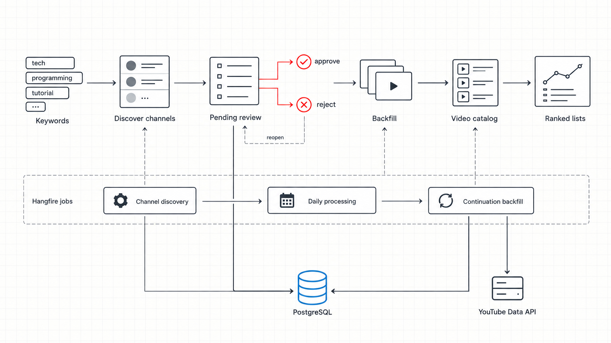

# YT Fetcher Workspace

This workspace combines the frontend and backend of **YT Fetcher**: an application for discovering, tracking, and updating high-performing YouTube videos by niche. Administrators can manage keywords and channels, run and review backfills, monitor YouTube API quota usage, and view video rankings and snapshot history.



## Repositories

| Component | Location | Purpose |
| --- | --- | --- |
| Frontend | [`fe`](fe/README.md) | Vue 3 admin interface for optional authentication, channel review, niche management, backfills, quota tracking, video rankings, and snapshot history. |
| Backend | [`be`](be/README.md) | ASP.NET Core API with PostgreSQL, scheduled processing, YouTube integration, and optional Firebase authentication. |

Each directory retains its own application documentation, configuration, dependencies, and CI workflow.

## Architecture Overview

```text
Admin (Vue frontend)
  -> ASP.NET Core API
  -> PostgreSQL
  -> YouTube Data API

Niche + keyword
  -> channel discovery
  -> admin review / approval
  -> quota-aware video backfill
  -> daily statistics polling + snapshots
  -> active and reference video rankings
```

The backend runs discovery and daily processing through Hangfire. The frontend surfaces the operational results and can use Firebase-based Google sign-in when authentication is enabled on the backend.

## Technology

- **Frontend:** Vue 3, TypeScript, Vite, Vue Router, SCSS, and pnpm.
- **Backend:** .NET 10 / ASP.NET Core, Entity Framework Core, Npgsql, PostgreSQL 17, Hangfire, Serilog, and xUnit.
- **Local infrastructure:** Docker Compose for PostgreSQL.

## Local Development

1. Prepare and run the backend first. Follow the database setup in the [backend README](be/README.md).

   ```powershell
   Set-Location be
   dotnet run --project .\src\YtFetcher.Api --launch-profile http
   ```

2. Prepare the frontend and set `VITE_API_BASE_URL` in its local environment file to the URL of the running backend.

   ```powershell
   Set-Location ..\fe
   pnpm install
   pnpm dev
   ```

3. If authentication is enabled, configure Firebase in both applications as documented in their respective READMEs. Never commit credentials or local configuration files.

## Configuration Note

The frontend documentation currently uses `https://localhost:10002` for the local API, while the backend `http` launch profile uses `http://localhost:10001`. Select the appropriate backend URL for your environment and use it consistently in the frontend configuration.

## Quality Checks

Run these commands from the workspace root:

```powershell
# Frontend
Set-Location fe
pnpm typecheck
pnpm build

# Backend
Set-Location ..\be
dotnet test
```
